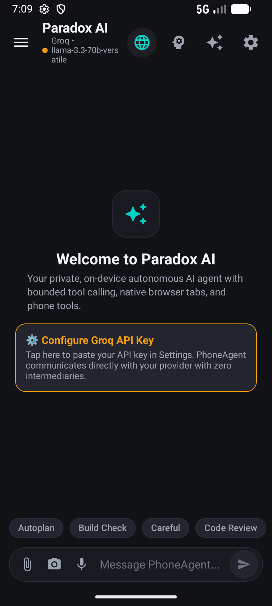
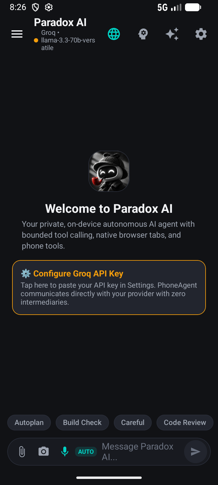
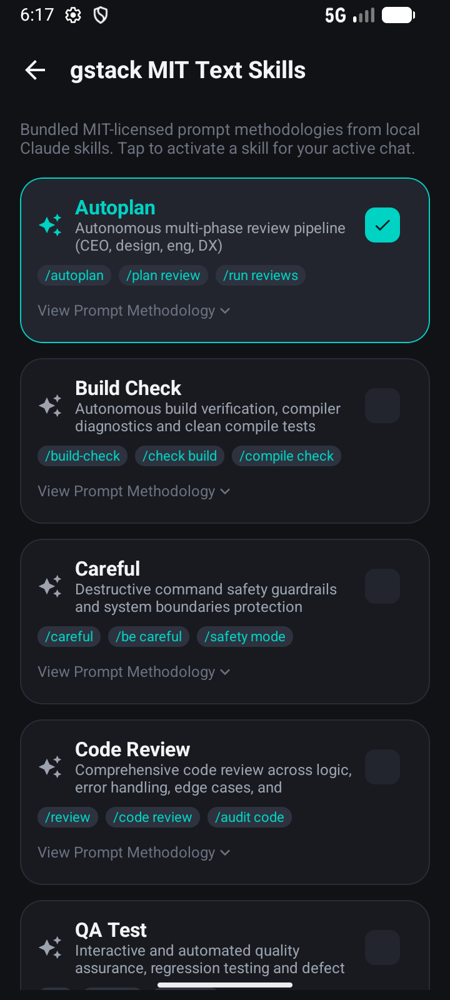
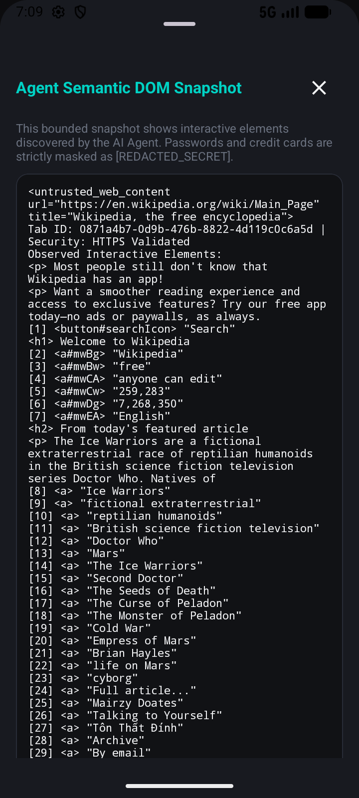
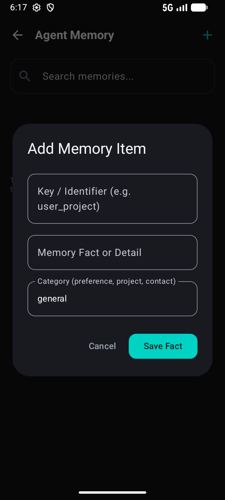
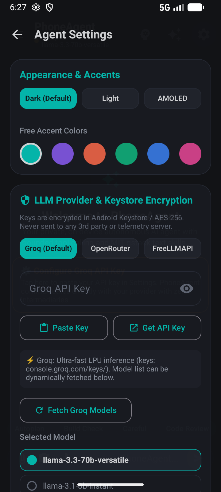
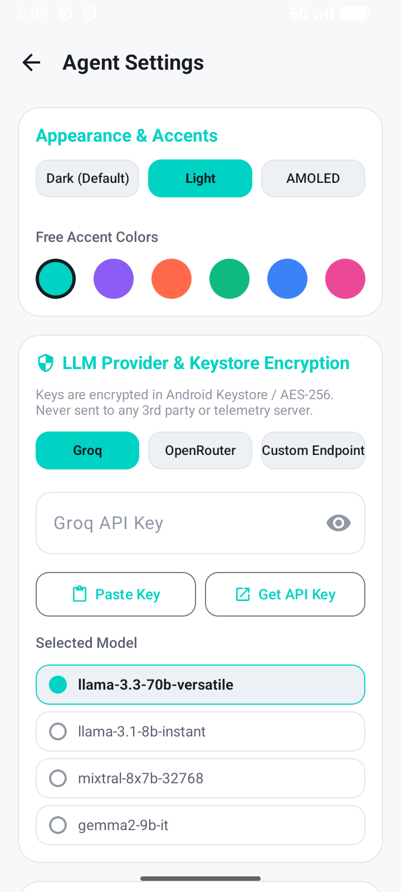
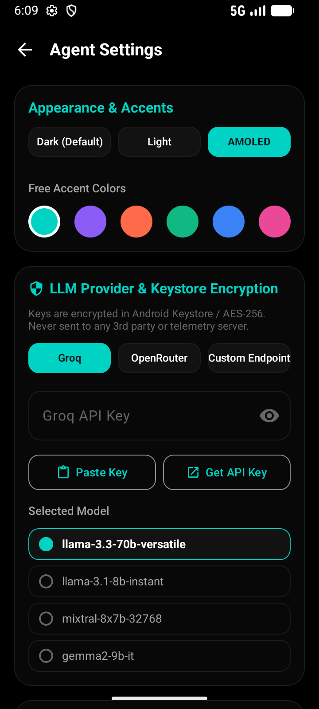

<p align="center">
  
</p>

<h1 align="center">Paradox AI</h1>

<p align="center">
  A private, on-device autonomous AI agent for Android. Bring your own key, keep your data on your phone.
</p>

<p align="center">
  
  
  
  
</p>

Paradox AI (package `com.phoneagent.ai`) is a native Android AI-agent app built with Jetpack Compose and Kotlin. It talks directly to your LLM provider (Groq, OpenRouter free tier, or any OpenAI-compatible endpoint) with no intermediary servers, no accounts, no telemetry, and no paid tiers. Your API keys live in the Android Keystore, encrypted with AES-256, and never leave the device except to the provider you chose.

## Screenshots

| Chat | Voice composer | Skills |
|---|---|---|
|  |  |  |

| Agentic browser tabs | Semantic DOM snapshot | Memory |
|---|---|---|
|  |  |  |

| Dark | Light | AMOLED |
|---|---|---|
|  |  |  |

## Features

### Agent chat
- Streaming chat over Server-Sent Events with live token deltas, thought-stream display, cancellation, and honest error states (no fake success messages).
- Bounded native tool loop: the model can call on-device tools, observe results, and continue, capped at a configurable iteration limit (default 5, max 10) so it can never spin forever.
- Chat history persisted locally; document result cards with Open / Share actions.

### On-device tools (19 total)
`calculator`, `datetime`, `device_info`, `web_fetch`, `local_file_read`, `local_file_search`, `memory_save`, `memory_recall`, `browser_navigate`, `browser_observe`, `browser_click`, `browser_fill`, `browser_scroll`, `browser_tab_create`, `browser_tab_switch`, `browser_tab_close`, `browser_tab_list`, `flashlight`, `call_phone`, plus document tools (`create_pdf`, `append_pdf`, `create_pptx`, `open_document`, `share_document`).

### Agentic browser
- Built-in multi-tab WebView browser the agent can navigate, read, click, fill, and scroll.
- Every page is observed as a bounded semantic DOM snapshot of interactive elements, wrapped in `<untrusted_web_content>` tags so page text is always treated as data, never as instructions.
- **Per-action confirmation**: any agent action that changes a page (click, fill, submit) first shows a dialog with the site, action, target, and proposed value. Default is deny; dismissal, navigation, or timeout all fail closed.
- Sensitive fields (passwords, OTP/2FA, credit cards, payment submission) are hard-blocked from agent input, and their values are masked as `[REDACTED_SECRET]` in observations.
- CSS selectors are passed through `JSONObject.quote` (injection-safe), SSL errors are strictly rejected, and purchase/payment keywords trigger mandatory human confirmation.

### Phone hardware tools
- Flashlight toggle via `CameraManager` with hardware detection.
- Phone calls go through `Intent.ACTION_DIAL` only: the number is pre-filled in the system dialer and a human always taps call. No silent background dialing.

### Voice (English + Hindi)
- Speech-to-text via Android `SpeechRecognizer` with an explicit language selector: English (`en-IN`), Hindi (`hi-IN`), or auto-detect.
- In-composer recording bar with live editable transcript and an 11-bar RMS-driven waveform. Cancel restores your typed draft; stop keeps the transcript as an editable draft. Nothing auto-sends.
- Spoken replies via TTS with proper audio focus (ducks music, releases on stop), per-message stop button, and locale availability checks.
- **Zero-secret-spoken guarantee**: API keys, passwords, tokens, document-attachment JSON, and code blocks are sanitized out before any text is spoken.
- Voice commands in both languages ("turn on flashlight" / "टॉर्च चालू करो", "call ..." / "कॉल करो", "search ...") dispatch straight to tools.
- Hindi (Devanagari) Unicode survives transcripts, chat storage, and generated PDFs without mojibake.

### Document creation and reading
- Multi-page PDFs generated on-device with native `PdfDocument`, verified in real time with `PdfRenderer`.
- Real, editable `.pptx` presentations generated as pure-Kotlin OpenXML ZIP packages, no heavy third-party binaries.
- Text extraction from PDF and PPTX attachments, wrapped in `<untrusted_user_file>` boundaries.
- Files stay in the app sandbox and are shared through `FileProvider` with read grants.

### Memory and skills
- Persistent key/value agent memory with categories and full-text search, usable from chat ("remember that ...") or a dedicated screen.
- 12 bundled MIT-licensed text skills (Autoplan, Build Check, Careful, Code Review, Daily Planner, Design Review, Document Creator, Executive Summary, Health, QA, Research Brief, Ship) that shape the agent's system prompt per chat.

### Appearance
- Dark (default), Light, and true-black AMOLED themes with 6 free accent colors and soft squircle design.

### LLM providers (bring your own key)
| Provider | Default model | Notes |
|---|---|---|
| Groq (default) | `llama-3.3-70b-versatile` | Dynamic `/models` fetch |
| OpenRouter | `openrouter/free` | **Free-tier enforced**: only `openrouter/free` or `:free` models are allowed; a paid model is rejected before any request is sent |
| Custom endpoint | user-set | Any OpenAI-compatible base URL (default `http://10.0.2.2:8000/v1` for local models) |

## Security and privacy model

- **Keystore-only keys**: API keys are stored in `EncryptedSharedPreferences` (AES-256 SIV/GCM) under an AES-256-GCM master key in the Android Keystore. If the Keystore is unavailable, key storage **fails closed**: plaintext fallback is strictly disabled.
- **No telemetry**: no analytics, crash-reporting, or ads SDKs. The only network calls are to your chosen LLM provider and pages you browse.
- **Fail-closed browser actions**: denial, dismissal, navigation, timeout, or DOM mutation while a confirmation is pending all abort the action.
- **Prompt-injection defenses**: untrusted web and file content is boundary-tagged; selectors are quoted; payment flows need explicit human approval.
- **Secrets never spoken or shown**: sanitization before TTS and redaction in DOM observations.
- Minimal permissions: `INTERNET`, `RECORD_AUDIO` (voice), `CAMERA` (flashlight). Runtime prompts with clear guidance when a service is missing.

## Architecture

Single Gradle module (`:app`), package `com.phoneagent.ai`:

```
app/src/main/java/com/phoneagent/ai/
├── MainActivity.kt                    # Compose host, navigation, theming, permissions
├── data/
│   ├── api/AiService.kt               # Provider API: model fetch, SSE streaming chat, tool loop
│   ├── browser/AgenticBrowserController.kt  # Multi-tab WebView control, DOM snapshot, confirmations
│   ├── browser/BrowserTab.kt          # Tab state model
│   ├── db/ChatStorage.kt              # Local chat persistence
│   ├── document/
│   │   ├── DocumentTextExtractor.kt   # Bounded PDF/PPTX text extraction
│   │   ├── PdfDocumentGenerator.kt    # Native multi-page PDF creation + PdfRenderer verify
│   │   └── PptxPresentationGenerator.kt # Pure-Kotlin OpenXML PPTX creation
│   ├── hardware/PhoneHardwareController.kt  # Flashlight, dialer intents
│   ├── model/Models.kt                # ChatMessage, AiProvider, themes, voice languages
│   ├── secure/KeyStoreManager.kt      # Keystore-backed key storage (fail-closed), settings
│   ├── skills/SkillsRepository.kt     # Bundled MIT text skills
│   ├── tools/NativeToolExecutor.kt    # All 19+ tool implementations, bounded execution
│   └── voice/
│       ├── VoiceManager.kt            # STT/TTS, audio focus, waveform RMS, sanitization
│       └── VoiceCommandDispatcher.kt  # EN/HI voice command parsing
└── ui/
    ├── components/Components.kt       # Shared Compose components
    ├── screens/                       # Chat, Browser, Memory, Skills, Settings
    └── theme/                         # Dark/Light/AMOLED + accent system
```

## Tech stack

Kotlin 2.0.21, Jetpack Compose (BOM 2024.11.00, Material 3), OkHttp 4.12 (SSE), kotlinx-coroutines 1.9, AndroidX Security Crypto 1.1.0-alpha06. AGP 8.7.2, Gradle 9.6.0 wrapper, Java 17. minSdk 26 (Android 8.0), target/compileSdk 35 (Android 15).

## Getting started

### Prerequisites
- JDK 17+
- Android SDK 35 (build-tools 35.0.0)

### Build
```bash
./gradlew assembleDebug
```
Output: `app/build/outputs/apk/debug/app-debug.apk`

### Run tests
```bash
./gradlew testDebugUnitTest          # 15 JVM unit tests (no device needed)
./gradlew connectedDebugAndroidTest  # 37 instrumented tests (device or emulator)
```

### Install
```bash
adb install -r app/build/outputs/apk/debug/app-debug.apk
```

On first launch, open Settings and paste a key from [console.groq.com/keys](https://console.groq.com/keys) (free) or [openrouter.ai/keys](https://openrouter.ai/keys), or point the custom endpoint at a local server.

## Download

Prebuilt APK (v1.0.0-beta, 18.5 MB) is attached to the [GitHub release](../../releases):

- **SHA-256**: `A7C71248DB6A908344E8C38E1010DBB3850A8B5B432FB21BFDCDEA89C069F9C8`
- Mirror: <https://files.catbox.moe/grn7vo.apk>

Always verify the checksum after downloading: `sha256sum paradox-ai-v1.0.0-beta.apk`

## Testing and QA

52/52 automated tests passing (100%):

- **37 instrumented tests** on a physical Samsung Galaxy A13 (SM-A135F, Android 14): prompt-injection defenses, sensitive-field blocking, confirmation allow/deny/timeout/dismiss flows, DOM-mutation-while-pending, multi-tab management, Hindi voice dispatch, PDF/PPTX generation and verification, memory persistence, bounded tool loop, SSE streaming, offline/cancellation handling, free-model enforcement.
- **15 JVM unit tests**: tool schema validation, untrusted-boundary wrapping, keystore fail-closed policy, TTS secret redaction, selector quoting, document extraction and packaging.

Full reports: [docs/QA-report.txt](docs/QA-report.txt), [docs/test-results.txt](docs/test-results.txt), [docs/status.json](docs/status.json). Build reproduction notes: [docs/build-notes.md](docs/build-notes.md). Feature acceptance detail: [docs/progress.md](docs/progress.md). Sample generated documents: [samples/](samples/).

## Honest limitations (beta)

- Speech recognition quality for mixed Hindi/English depends on the speech engine installed on the device.
- PDF/PPTX support is practical, not Acrobat/Office parity.
- Injection and payment defenses are defense-in-depth for the tested cases, not a claim of general immunity.
- Phone calls always require a human tap in the system dialer; hardware actions depend on device capabilities.

## License

[GPL-3.0](LICENSE). Bundled text skills are MIT-licensed prompt methodologies. The launcher artwork was supplied by the project owner.
